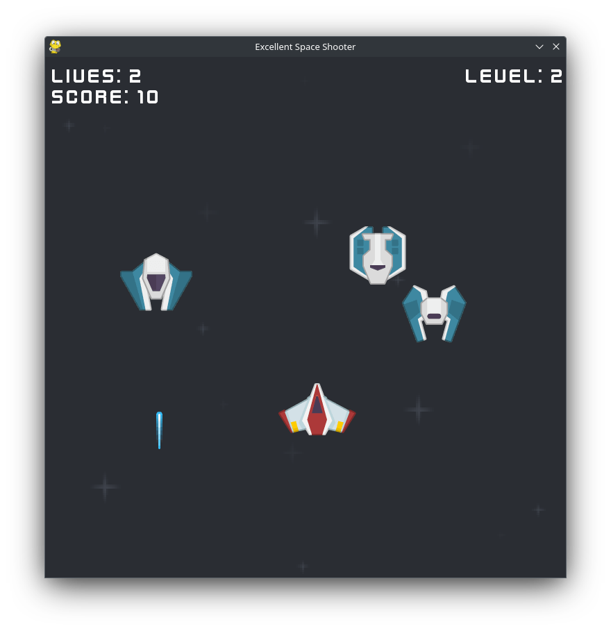

<h1 align="center"> 🚀 Excellent Space Shooter </h1>

<p align="center">
This is a simple 2D space shooter created using the Pygame library in Python.
The objective of the game is to survive as long as possible and defeat as many enemies as possible. 👾
</p>

<p align="center">
    
</p>


## ⚙️ Setup

To run the game, you will need Python and the Pygame library installed.
If you don't have Pygame installed, you can install it using pip:
```bash
pip3 install pygame
```

## 🕹️ How to Play

To start the game, run the `main.py` file:
```bash
python3 main.py
```

## 🎮 Controls & Features
- **Main Menu**: Start new games, view Highscores and leaderboard history, adjust audio settings, or quit.
- **Audio Settings**: Adjust background music volume and sound effects (SFX) with interactive volume sliders and test sound preview. Accessible from the Main Menu and Pause Menu.
- **Movement**: Arrow keys or WASD to move your spaceship.
- **Shoot**: `SPACE` to fire lasers.
- **Pause**: `ESC` to pause the game, open audio settings, restart, or return to the main menu.
- **Highscores**: When your ship is destroyed, you can enter your pilot name to save your score, level reached, and date/time. View your best scores and timeline history in the Highscore menu!

## 🧩 Assets

Thanks to Kenney.nl for Space Shooter Redux
(https://opengameart.org/content/space-shooter-redux)

Thanks to Tad for Soundtrack (https://opengameart.org/content/8-bit-pack-1)

## 👨‍🏫 Tutorial
Thanks for a good Tutorial at Tech With Tim (https://www.youtube.com/watch?v=Q-__8Xw9KTM)

It helped me get started a lot.